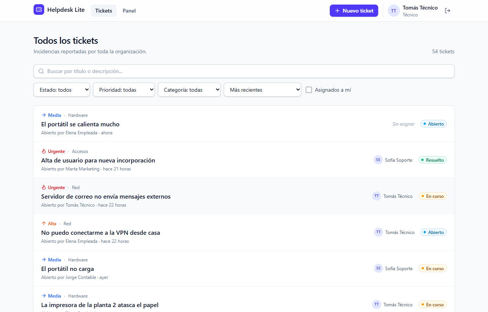
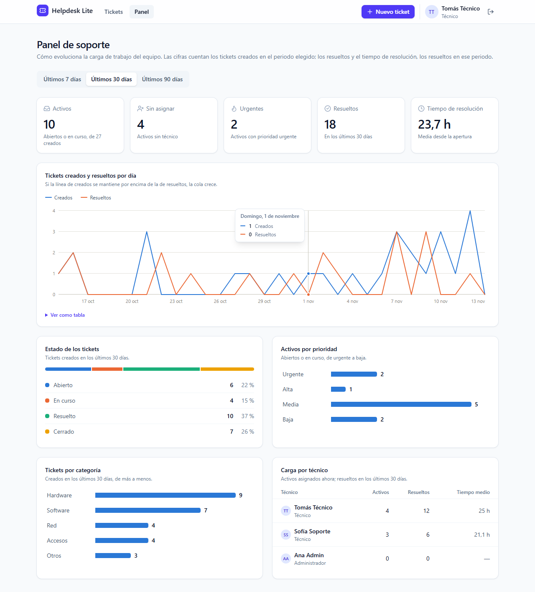
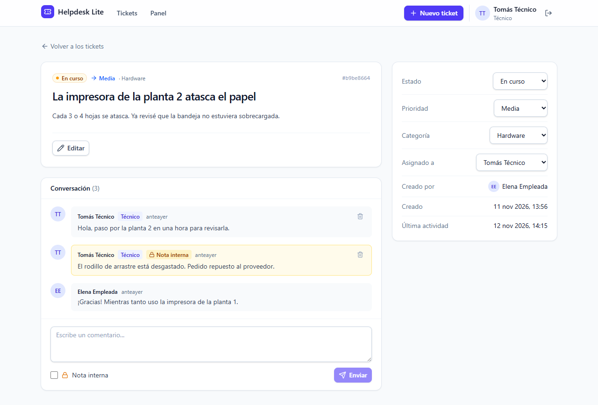
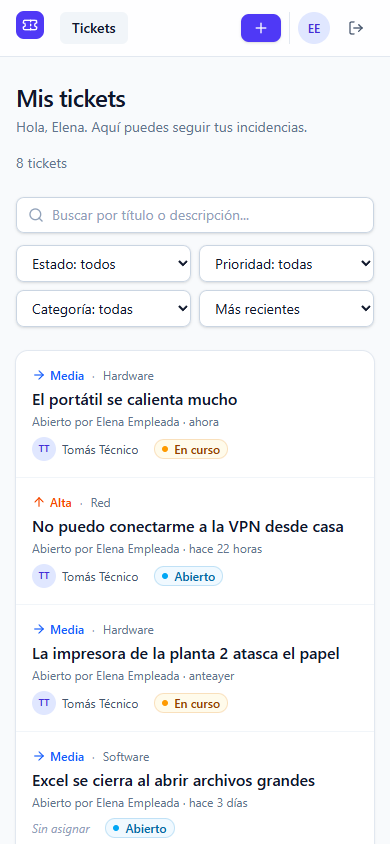

# 🎫 Helpdesk Lite

> IT support ticket management system · Full Stack with TypeScript

[Español](./README.md) | **English**

[](https://github.com/Nicolasdkr/helpdesk-lite/actions/workflows/ci.yml)




<details>
<summary><b>Metrics dashboard</b> (technicians and admins)</summary>



</details>

<table>
  <tr>
    <td width="68%"></td>
    <td width="32%"></td>
  </tr>
  <tr>
    <td align="center"><sub>Details: conversation, internal note (in yellow) and technician panel</sub></td>
    <td align="center"><sub>Mobile-friendly layout</sub></td>
  </tr>
</table>

> The UI is in Spanish, as the app targets Spanish-speaking teams.

## 📌 Overview

**Helpdesk Lite** lets employees report IT issues and lets support technicians manage them end to end: assignment, prioritization, follow-up through comments, and closure.

**Problem it solves:** in small teams, issues arrive by email, chat, or word of mouth and get lost. Helpdesk Lite centralizes everything in a traceable workflow with clear statuses and owners.

## ✨ Features

- [x] REST API with input validation and centralized error handling
- [x] Data model: users, tickets, and comments
- [x] JWT authentication with roles (`ADMIN`, `AGENT`, `USER`)
- [x] Ticket CRUD with filters, search, sorting, and pagination
- [x] Ticket assignment to technicians and a validated status workflow
- [x] Ticket comments, with internal notes visible only to support staff
- [x] Support metrics dashboard: KPIs, created vs. resolved per day, status, priority, category, and per-technician workload
- [x] React frontend: login with demo accounts, list with URL-based filters, ticket details with conversation and role-based actions
- [x] Continuous integration with GitHub Actions

## 🛠️ Tech stack

| Layer | Technology | Why |
|-------|------------|-----|
| Frontend | React + Vite + TypeScript + Tailwind CSS | Industry standard, fast startup |
| Backend | Node.js + Express 5 + TypeScript | One language across the stack |
| Validation | Zod | Reusable typed schemas |
| ORM | Prisma 7 | Versioned migrations and generated types |
| Database | PostgreSQL 17 | Relational, robust, and free |
| Frontend data | TanStack Query | Caching, retries, and loading states without boilerplate |
| Forms | React Hook Form + Zod | Same validation rules as the backend |
| Tests | Vitest + Supertest + Testing Library | Fast, modern syntax |
| Infrastructure | Docker + Docker Compose | One command to run everything |

## 🏗️ Architecture

```
helpdesk-lite/
├── backend/
│   ├── prisma/              # Database schema and migrations
│   ├── src/
│   │   ├── config/          # Validated environment variables
│   │   ├── lib/             # Prisma client, HTTP errors
│   │   ├── middlewares/     # Auth, error handling
│   │   ├── modules/         # One module per domain (routes → controller → service)
│   │   ├── app.ts           # Express setup (testable)
│   │   └── server.ts        # Entry point
│   └── tests/
├── frontend/
│   ├── src/
│   │   ├── auth/            # Session (context), route protection
│   │   ├── components/      # Reusable UI, layout, and ticket pieces
│   │   ├── features/        # Data hooks per domain (TanStack Query)
│   │   ├── lib/             # HTTP client, formatting, and labels
│   │   ├── pages/           # One page per route (lazy-loaded)
│   │   └── types/           # API response types
│   └── nginx.conf           # Serves the SPA and proxies /api in Docker
├── docs/                    # Screenshots and Postman collection
└── docker-compose.yml
```

Each domain module follows a layered architecture:

- **routes**: defines endpoints and middlewares.
- **controller**: translates HTTP ↔ data (reads `req`, writes `res`).
- **service**: business logic; knows nothing about Express.
- **schemas**: input validation with Zod.

## 🚀 Getting started

### Requirements

- [Docker Desktop](https://www.docker.com/products/docker-desktop/)
- [Node.js 24+](https://nodejs.org/) (option B only)

### Option A — Everything in Docker (fastest)

```bash
git clone https://github.com/Nicolasdkr/helpdesk-lite.git
cd helpdesk-lite
docker compose up --build -d

# Create the demo users
docker compose exec backend npx prisma db seed
```

Open **http://localhost:8080** and sign in with one of the demo accounts (the login page has buttons to fill them in).
The API is available at http://localhost:3000/api.

### Option B — Local development (hot reload)

```bash
# 1. Start only the database
docker compose up -d db

# 2. API (terminal 1)
cd backend
cp .env.example .env
npm install
npm run db:migrate
npm run db:seed
npm run dev

# 3. Frontend (terminal 2)
cd frontend
npm install
npm run dev
```

Open **http://localhost:5173**. Vite forwards `/api` requests to the API on port 3000.

### 🧰 Trying the API

- **VS Code:** open [`backend/requests.http`](./backend/requests.http) with the **REST Client** extension and click *Send Request*.
- **Postman:** *Import* → [`docs/postman/helpdesk-lite.postman_collection.json`](./docs/postman/helpdesk-lite.postman_collection.json). Run the three logins in the **Auth** folder first: each one saves its token to the collection variables automatically.

### 👥 Demo users

All of them use the password `Password123!`

| Role | Email | Can |
|------|-------|-----|
| ADMIN | `admin@helpdesk.dev` | Everything, including user management |
| AGENT | `agent@helpdesk.dev` | Handle and resolve tickets |
| USER | `user@helpdesk.dev` | Create and follow their own tickets |

The seed also creates a second technician (`agent2@helpdesk.dev`), two employees, and a **history of about 45 tickets** spread over 75 days. It uses a fixed-seed pseudo-random generator, so the metrics dashboard has realistic data and looks the same on every machine.

### Useful scripts

In `frontend/`: `npm run dev` (Vite), `npm test`, `npm run lint`, `npm run build`.

In `backend/`:

| Command | Description |
|---------|-------------|
| `npm run dev` | API with auto-reload |
| `npm test` | Run tests |
| `npm run typecheck` | Type-check with TypeScript |
| `npm run build` | Compile to JavaScript in `dist/` |
| `npm run db:migrate` | Create/apply migrations |
| `npm run db:seed` | Create the demo users, tickets, and history |
| `npm run db:studio` | Visual database browser |

## 📡 API

Protected routes require the `Authorization: Bearer <token>` header. Get a token from `/api/auth/login`.

| Method | Route | Access | Description |
|--------|-------|--------|-------------|
| GET | `/api/health` | Public | Service status |
| GET | `/api/health/ready` | Public | Database connection status |
| POST | `/api/auth/register` | Public | Sign up (always with the `USER` role) |
| POST | `/api/auth/login` | Public | Log in, returns a JWT |
| GET | `/api/auth/me` | Authenticated | Current user profile |
| GET | `/api/users` | `ADMIN` | List users |
| GET | `/api/users/agents` | `AGENT`, `ADMIN` | Technicians a ticket can be assigned to |
| GET | `/api/metrics?days=7\|30\|90` | `AGENT`, `ADMIN` | Dashboard metrics: summary, distributions, daily series, and workload |
| GET | `/api/tickets` | Authenticated | Paginated list with filters (see below) |
| POST | `/api/tickets` | Authenticated | Create a ticket |
| GET | `/api/tickets/:id` | Authenticated | Ticket details |
| PATCH | `/api/tickets/:id` | Creator, `AGENT`, `ADMIN` | Edit title, description, priority, or category |
| PATCH | `/api/tickets/:id/status` | `AGENT`, `ADMIN` | Change status |
| PATCH | `/api/tickets/:id/assign` | `AGENT`, `ADMIN` | Assign or unassign (`null`) a technician |
| DELETE | `/api/tickets/:id` | `ADMIN` | Delete a ticket (and its comments) |
| GET | `/api/tickets/:id/comments` | Authenticated | Ticket comments, in chronological order |
| POST | `/api/tickets/:id/comments` | Authenticated | Add a comment (`isInternal: true` only `AGENT`/`ADMIN`) |
| DELETE | `/api/tickets/:id/comments/:commentId` | Author, `ADMIN` | Delete a comment |

**`GET /api/tickets` query parameters:**

| Parameter | Values |
|-----------|--------|
| `status` | `OPEN`, `IN_PROGRESS`, `RESOLVED`, `CLOSED` |
| `priority` | `LOW`, `MEDIUM`, `HIGH`, `URGENT` |
| `category` | `HARDWARE`, `SOFTWARE`, `NETWORK`, `ACCESS`, `OTHER` |
| `assignedToId` | A technician's UUID or `me` |
| `search` | Text to search in title and description |
| `sort` / `order` | `createdAt`, `updatedAt` or `priority` / `asc` or `desc` |
| `page` / `pageSize` | Page (from 1) / size (max 50) |

The response includes `{ data: [...], meta: { page, pageSize, total, totalPages } }`.

### Business rules

| Action | USER | AGENT | ADMIN |
|--------|:----:|:-----:|:-----:|
| View tickets | Own only | All | All |
| Create ticket | ✅ | ✅ | ✅ |
| Edit title/description | Own only, while `OPEN` | ✅ | ✅ |
| Change priority/category | ❌ | ✅ | ✅ |
| Change status / assign | ❌ | ✅ | ✅ |
| Delete | ❌ | ❌ | ✅ |
| Comment | On own tickets | ✅ | ✅ |
| See / write internal notes | ❌ | ✅ | ✅ |

**Status workflow:** `OPEN → IN_PROGRESS → RESOLVED → CLOSED`. A resolved ticket can be reopened (`RESOLVED → IN_PROGRESS`) and `CLOSED` is final. Invalid transitions return `409`.

If a `USER` requests someone else's ticket, the API returns `404` (not `403`) so it doesn't reveal that the ticket exists.

`CLOSED` tickets cannot be commented on. Commenting updates the ticket's "last activity" (`updatedAt`).

All error responses share the format `{ "error": { "message": "...", "details": { ... } } }`.

## 🔐 Security

- Passwords hashed with **bcrypt** and never returned in responses.
- **JWTs** signed with an environment secret and with an expiry.
- Public sign-up cannot choose a role: `AGENT` and `ADMIN` are assigned only by an admin.
- Login returns the same error whether the email doesn't exist or the password is wrong, so it doesn't reveal which accounts exist.
- Secure HTTP headers with **Helmet** and restricted CORS.
- The frontend stores the JWT in `localStorage` for simplicity. In production, an `httpOnly` cookie (unreadable from JavaScript) would be safer.

## 🧪 Tests

```bash
cd backend && npm test    # 71 integration tests against PostgreSQL
cd frontend && npm test   # component tests with Testing Library
```

Integration tests use a separate database (`helpdesk_test`) that Docker Compose creates automatically, so they never touch your development data.

Frontend tests render pages with a mocked `fetch`. They cover form validation, login, filters, and which page you return to after signing in.

### ⚙️ Continuous integration

[GitHub Actions](./.github/workflows/ci.yml) runs on every push to `main` and on every Pull Request:

1. Starts a real PostgreSQL service.
2. **Backend:** installs dependencies, type-checks, runs every test, and builds, on **Node 24 and 26**.
3. **Frontend:** lint, type-check, tests, and production build.
4. Builds the backend and frontend Docker images.

A PR is merged only when everything is green.

## 🩺 Troubleshooting

| Symptom | Cause | Fix |
|---------|-------|-----|
| `503 Base de datos no disponible` | Docker Desktop or the `db` container is stopped | Open Docker Desktop and run `docker compose up -d db`. Check with `GET /api/health/ready` |
| `400 El cuerpo de la petición no es un JSON válido` | Malformed JSON (trailing commas, “smart” quotes…) | In Postman use *Body → raw → JSON* |
| `401 Falta el token de acceso` | The JWT was not sent | Add the `Authorization: Bearer <token>` header (the Postman collection does it after login) |
| Tests fail with `database "helpdesk_test" does not exist` | The Postgres volume was created before the test DB was added | `docker exec helpdesk-db psql -U helpdesk -c "CREATE DATABASE helpdesk_test OWNER helpdesk;"` |

## 🗺️ Roadmap

See the checkboxes under [Features](#-features). Future ideas: email notifications, attachments, SLA per priority.

## 🤝 Contributing

See [CONTRIBUTING.md](./CONTRIBUTING.md) for commit and branch conventions.

## 📄 License

[MIT](./LICENSE)

## 👤 Author

**Nicolas** — Junior Full Stack Developer
[LinkedIn](https://www.linkedin.com/in/nicolas-maldonado-a8519739b/) · [GitHub](https://github.com/Nicolasdkr)
